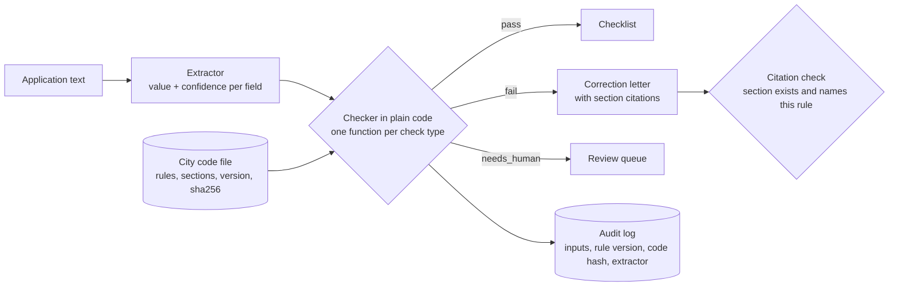

# permitcheck

[](https://github.com/shreyas-tech7/permitcheck/actions/workflows/ci.yml)

> **SYNTHETIC DATA ONLY. Larkspur Hollow and its code are fictional. This tool gives no legal advice. Not for production use.**

**Status:** release candidate v0.1.0-rc1. The rule-based extractor works end to end and carries every number below. The LLM extractor is built and tested offline, but it is untested live, because this build had no provider key and no network route to a free provider.

permitcheck reads a permit application, checks it against a city code with section citations, and writes a reviewer checklist, a correction letter and a review queue. The model reads. Code decides.

## The problem

Cities now buy software that does a first pass on permit plans. A wrong "approve" costs more than a wrong "reject". A missed footing depth or a deck too close to the lot line gets built, inspected late and torn out. A wrong reject costs the applicant a day and an email.

So this demo measures one number above the rest: the false-approve rate. A **false approve** is an application with at least one seeded critical violation that the tool marks as pass on that rule.

permitcheck keeps the risky judgment out of the model. An extractor pulls each field with a confidence score. Plain Python checks each rule. When a field is missing, unclear or read with low confidence, the rule goes to a person as needs-human. The tool never guesses a pass.

Everything runs on a fictional city, Larkspur Hollow, with a code written from scratch for this demo:

<!-- facts:start -->

- City code: Larkspur Hollow Residential Code (LHRC) version 2026.1, 25 rules, 13 of them critical (R06, R07, R08, R09, R10, R12, R13, R14, R17, R18, R19, R22, R23).
- Applications: 300 synthetic applications from seed 20261120, split into 200 dev and 100 held-out before any tuning.
- Confidence threshold: a field read below 0.8 confidence sends its rule to a person.
<!-- facts:end -->

## How it works



1. `permitcheck check` reads one application.
2. The extractor (`src/permitcheck/extract.py`, or `llm.py` for the model) returns a value, a confidence and the source line for each field.
3. The checker (`src/permitcheck/checker.py`) runs every rule that applies to the project type. A missing or low-confidence value is needs-human.
4. The report writer (`src/permitcheck/report.py`) writes the checklist, the letter and the queue. The letter may cite only sections the checker returned, and it raises an error on any other section.
5. The audit writer (`src/permitcheck/audit.py`) appends one line per decision.

## Results

These tables come from the files in `results/`. The `permitcheck readme` command writes them, and a test fails if they drift. The rule-based extractor carries every number. No model ran, and no recorded fixtures feed these numbers.

<!-- results:start -->
| Metric | Dev (200 apps, seed 20261120) | Held-out (100 apps, seed 20261120) | Second seed (300 apps, seed 20261121) |
| --- | --- | --- | --- |
| Field F1 | 0.973 | 0.971 | 0.970 |
| Field precision | 98.4% (3789 of 3852), CI 97.9% to 98.7% | 98.3% (1883 of 1915), CI 97.7% to 98.8% | 98.3% (5714 of 5811), CI 98.0% to 98.6% |
| Field recall | 96.2% (3789 of 3938), CI 95.6% to 96.8% | 95.8% (1883 of 1965), CI 94.8% to 96.6% | 95.8% (5714 of 5967), CI 95.2% to 96.2% |
| Violation precision | 100.0% (167 of 167), CI 97.8% to 100.0% | 100.0% (90 of 90), CI 95.9% to 100.0% | 100.0% (268 of 268), CI 98.6% to 100.0% |
| Violation recall | 90.3% (167 of 185), CI 85.1% to 93.8% | 88.2% (90 of 102), CI 80.6% to 93.1% | 88.7% (268 of 302), CI 84.7% to 91.8% |
| **False-approve rate** (applications with a critical violation) | 0.0% (0 of 77), CI 0.0% to 4.8% | 0.0% (0 of 47), CI 0.0% to 7.6% | 0.0% (0 of 134), CI 0.0% to 2.8% |
| False approves per critical violation | 0.0% (0 of 103), CI 0.0% to 3.6% | 0.0% (0 of 63), CI 0.0% to 5.7% | 0.0% (0 of 172), CI 0.0% to 2.2% |
| Needs-human rate (rule decisions) | 13.2% (452 of 3430), CI 12.1% to 14.4% | 11.9% (203 of 1708), CI 10.4% to 13.5% | 11.9% (611 of 5136), CI 11.0% to 12.8% |
| Citation validity (fixed count, no interval) | 100.0% (619 of 619) | 100.0% (293 of 293) | 100.0% (879 of 879) |

Extractor: `rule-v1`. Model: none (rule-based, no model). Code: LHRC 2026.1. Run date: 2026-11-20. CI means a 95% Wilson score interval.

The held-out set holds 63 seeded critical violations in 47 applications. The tool marked 0 of them as pass. A zero count from a sample this small still leaves a 95% upper bound of 5.7% per critical violation, so this run cannot rule out a rare false approve.
<!-- results:end -->

The checker never swapped a pass for a fail in these runs. Every disagreement with the answer key is a pass or fail case that the tool sent to a person instead, mostly applications that use labels the extractor does not know.

## Cost per task

<!-- cost:start -->

$0.00 per application. The rule-based extractor makes 0 model calls. One application takes 11.98 ms to extract, check and write all three outputs (300 applications, best of 3, 2 cores of an Intel(R) Xeon(R) Processor @ 2.10GHz, Python 3.13.18, 2026-11-20, from `results/timing.json`).
<!-- cost:end -->

The LLM extractor would add one model call per application. It targets free tiers only, so the planned cost is also zero, but no live run has measured it.

## Run it in ten minutes

You need Python 3.11 or newer and [uv](https://docs.astral.sh/uv/).

```bash
git clone https://github.com/shreyas-tech7/permitcheck.git
cd permitcheck
./init.sh                      # makes .venv, installs, lints, runs every test offline
source .venv/bin/activate
permitcheck check data/applications/LH-APP-0018.txt --out out
cat out/LH-APP-0018/letter.md
permitcheck eval --split both --check   # rerun the eval and compare with results/
permitcheck readme --check              # confirm the README tables match results/
```

`permitcheck generate --out /tmp/apps` writes a fresh synthetic set. The worked examples in [examples/](examples/) show every output for two applications, with their terminal transcripts. [docs/index.html](docs/index.html) opens from disk and shows the results without a server. [docs/DEMO.md](docs/DEMO.md) holds a real terminal session.

To try the LLM extractor live, put a free Groq key in `.env` as `GROQ_API_KEY` and run `permitcheck eval --extractor llm-record --split heldout`. Record mode sends only synthetic text and saves each response under `fixtures/llm/`, so later runs replay it offline.

## Limits

- The data is synthetic. It shows that the code handles the cases the generator makes. It cannot show how real applications read, how real applicants word things, or how often real plans break each rule.
- The city code is fictional and small. Real codes have hundreds of sections, local amendments and cross references.
- The extractor reads text only. It does not read plan drawings, photos or scans as images.
- The rule-based extractor knows a fixed list of labels. An application with an unusual label sends that rule to a person. That is safe, but it raises the needs-human rate.
- The false-approve count is zero, but the sample is small. The Wilson upper bound in the table shows how large the true rate could still be.
- The LLM extractor is untested live. Its grounding check caps the confidence of any value whose quote does not appear in the text, which sends that rule to a person.
- Nobody has shown this tool to a real permit reviewer.

## Glossary

- **Critical rule:** a rule whose violation could make a structure unsafe, such as a setback, the guard height or the footing depth.
- **False approve:** an application with at least one seeded critical violation that the tool marks as pass on that rule.
- **Needs-human:** the result when the tool cannot decide. A person reviews it.
- **Answer key:** the hidden truth for each synthetic application, written by the generator.
- **Held-out set:** applications set aside before any tuning and scored once at the end.
- **Wilson interval:** a 95% range for a rate measured on a small sample. It stays useful when the count is zero.
- **Grounding check:** a test that the quote the model gives appears in the application and parses to the same value.
- **Replay mode:** the LLM extractor reads saved responses instead of calling a provider, so tests run offline.

## Related work

Vendors already sell plan review tools, for example CodeComply.Ai from CivicPlus, Clariti's CivCheck and Blitz AI. [Archistar](https://archistar.ai/) says that its AI PreCheck tool is trusted by more than thirty cities and local governments. permitcheck is a small open demo with a public answer key and an eval harness. It makes no claim to match any vendor.

## How this was built

AI agents wrote most of the code under Shreyas's direction. The full build prompt is in [docs/build/BUILD_PROMPT.md](docs/build/BUILD_PROMPT.md). Choices and their reasons are in [DECISIONS.md](DECISIONS.md), and open problems are in [BLOCKERS.md](BLOCKERS.md).

Human checks, not done yet:

- Shreyas reads the code and the diff: not done yet.
- Shreyas reruns `./init.sh` and the eval on his own machine: not done yet.
- A live record run with a free provider key: not done yet.
- A real permit reviewer looks at the outputs: not done yet. Shreyas will ask first.

## License

MIT. See [LICENSE](LICENSE). The city, its code and every application are fictional and made for this demo. This tool gives no legal advice and is not for production use.
